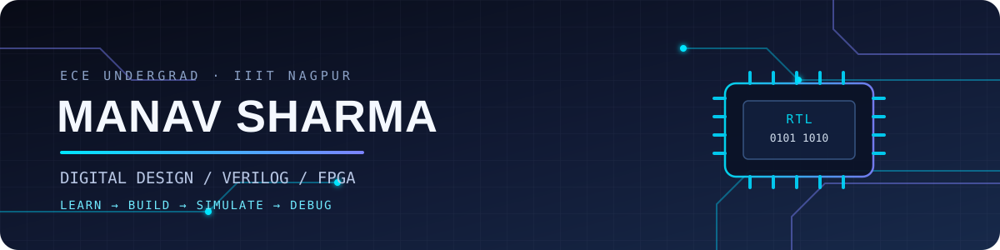

<div align="center">
  

  <a href="https://readme-typing-svg.demolab.com?font=JetBrains+Mono&weight=500&size=18&duration=2600&pause=750&color=00D9FF&center=true&vCenter=true&width=720&lines=Designing+logic%2C+one+bit+at+a+time.;Verilog+%E2%80%A2+Digital+Design+%E2%80%A2+FPGA;From+simulation+to+real+hardware.;Exploring+RTL+design+%26+SoC+verification.">
    
  </a>

  <p>
    <a href="https://github.com/manavv5"></a>
    <a href="https://github.com/manavv5?tab=repositories"></a>
  </p>
</div>

---

## `01 / about_me`

I'm **Manav Sharma**, an Electronics and Communication Engineering undergraduate at **IIIT Nagpur** (Class of 2029), interested in the space where digital hardware meets software.

I like understanding how a design moves from **logic → RTL → simulation → hardware**. I'm building my foundations through hands-on digital-design projects and experimenting with an FPGA board—not just collecting tools or badges.

```text
FOCUS       Digital logic · Verilog · FPGA
HARDWARE    Sipeed Tang Nano 9K
EXPLORING   RTL design · SoC verification · Embedded systems
APPROACH    Learn → Build → Simulate → Debug → Document
```

## `02 / selected_projects`

<table>
  <tr>
    <td width="50%" valign="top">
      <h3>01 · Tang Nano 9K — 2:1 MUX</h3>
      <a href="https://github.com/manavv5/tang-nano-9k-2to1-mux"></a>
      <p>A small RTL design taken beyond simulation and deployed on the Sipeed Tang Nano 9K.</p>
      <ul><li>Verilog implementation and pin constraints</li><li>Physical-board demonstration</li><li>RTL-to-hardware workflow</li></ul>
      <a href="https://github.com/manavv5/tang-nano-9k-2to1-mux">View repository ↗</a>
    </td>
    <td width="50%" valign="top">
      <h3>02 · 4-Bit ALU</h3>
      <a href="https://github.com/manavv5/4-Bit-ALU"></a>
      <p>A combinational arithmetic logic unit explored in Logisim.</p>
      <ul><li>Addition and subtraction</li><li>Bitwise AND, OR and XOR</li><li>Datapath and processor-design concepts</li></ul>
      <a href="https://github.com/manavv5/4-Bit-ALU">View repository ↗</a>
    </td>
  </tr>
  <tr>
    <td width="50%" valign="top">
      <h3>03 · 8-Bit LFSR</h3>
      <a href="https://github.com/manavv5/8_bit-LFSR"></a>
      <p>An 8-bit linear-feedback shift register exploring feedback logic and state evolution.</p>
      <a href="https://github.com/manavv5/8_bit-LFSR">View repository ↗</a>
    </td>
    <td width="50%" valign="top">
      <h3>04 · Full-Wave Bridge Rectifier</h3>
      <a href="https://github.com/manavv5/LTspice_FullWaveBridgeRectifier"></a>
      <p>An LTspice simulation of AC-to-DC conversion with a bridge rectifier and capacitor filter.</p>
      <ul><li>Transient analysis</li><li>Ripple-voltage calculation and comparison</li></ul>
      <a href="https://github.com/manavv5/LTspice_FullWaveBridgeRectifier">View repository ↗</a>
    </td>
  </tr>
</table>

## `03 / toolbox`

<div align="center">

**Hardware & design**


**Programming & tools**


</div>

## `04 / what_im_working_towards`

- **RTL fundamentals** — writing clear, synthesizable Verilog and understanding hardware behavior.
- **Verification habits** — building useful testbenches, checking corner cases and debugging simulations.
- **FPGA practice** — taking designs from source code onto a real board.
- **Hardware/software interfaces** — exploring embedded systems and how digital blocks communicate.

## `05 / github_activity`

<div align="center">
  
  
</div>

## `06 / connect`

I'm always happy to connect with people who enjoy **digital design, FPGA development, embedded systems, and learning by building**.

<div align="center">
  <a href="https://github.com/manavv5?tab=followers"></a>

  *Think in logic. Build in hardware. Keep iterating.*
</div>
